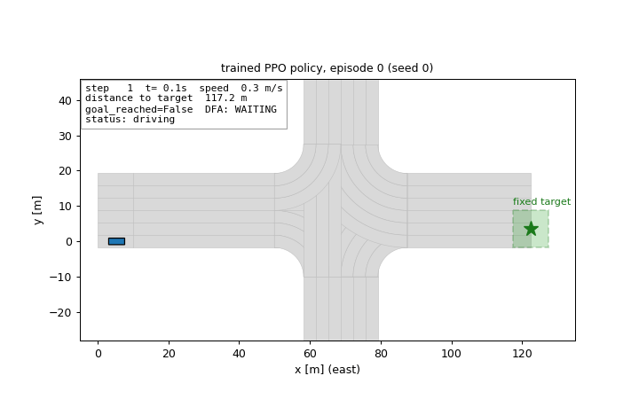

# Static-waypoint baseline in MetaDrive (4-way intersection)

> **Repository layout.** Three static-goal experiments, each building on the previous one. The folders import
> from each other by sibling name, so keep them side by side:
>
> | Folder | Training script | Setup |
> |---|---|---|
> | `static_goal/` | `train_static_goal.py` | fixed destination, no traffic |
> | `static_goal_traffic/` | `train_traffic.py` | + IDM traffic |
> | `static_goal_traffic_full_state/` | `train_full_state.py` | + 137-dim full-state observation |
>
> Setup: `bash setup.sh` (clones MetaDrive @ `fe54b03` into `upstream/`, creates the venv at
> `~/.venvs/metadrive-static-goal`). Checkpoints, `runs/` and `logs/` are not in the repo.

One ego car learns, with PPO, to start on the left (west) approach, drive straight across a 4-way intersection,
and reach a fixed target region on the right (east) exit. There is no traffic. It runs on a CPU laptop.



**Result:** after 1,000,000 env steps (4 min 44 s of training), the trained policy reached the target in
**20/20** evaluation episodes. The untrained policy reached it in **0/20**: it times out without moving.
See [Results](#results), including the caveats.

> **Provisional environment.** No teammate environment or config file was found on this machine. The only
> MetaDrive-related items were slide decks, and `Capstone/metadrive/` was empty. This baseline therefore uses
> MetaDrive's built-in intersection (`map="X"`). Swap in the teammate's map once it is available.

## 1. What the existing code does (read from source, MetaDrive commit `fe54b03`)

| Question | Answer |
| --- | --- |
| Simulator / env class | MetaDrive 0.4.3 (Panda3D + Bullet). `MetaDriveEnv` ([metadrive_env.py](upstream/metadrive/envs/metadrive_env.py)), procedural map `map="X"`: `FirstPGBlock` + `StdInterSection` ([intersection.py](upstream/metadrive/component/pgblock/intersection.py)). |
| Routes / checkpoints / destination | Roads are graph edges between named nodes (`">"`, `">>"`, `"1X1_0_"`, …). `NodeNetworkNavigation.set_route` takes the shortest path from the spawn lane to the vehicle config's `destination` node. That path is the list of **checkpoints**. `final_lane` is a lane of the last road. If `destination=None`, MetaDrive picks a **random** exit ([node_network_navigation.py](upstream/metadrive/component/navigation_module/node_network_navigation.py)). |
| Navigation → policy | The observation is `LidarStateObservation`, 259 dims: ego state, then 10 navigation numbers, then 240 lidar values. The navigation numbers describe the **next two checkpoints**: position in the ego frame (clipped at 50 m), lane bend radius, direction and angle. They come from the route, so they change if the destination changes. |
| Arrival | `_is_arrive_destination`: the car is within ±5 m of the end of `final_lane`, and laterally within the final road's lanes. |
| Reward | Progress along the route's reference lane, plus 0.1 × normalised speed. On the arrival step the reward is replaced by +10; on an off-road or crash step it is replaced by −5. |
| Termination | Arrival, off-road (including crossing a solid line), crash, or `horizon` steps (truncation). |

## 2. The task (what was kept, what was added)

Code: [static_goal/static_goal_env.py](static_goal/static_goal_env.py), about 60 lines on top of `MetaDriveEnv`.

| | Definition |
| --- | --- |
| Route | Spawn road `> → >>` (west approach, heading east), straight through the intersection, then exit road `1X1_0_ → 1X1_1_`, about 120 m in total. |
| Fixed target | `destination = "1X1_1_"`: the end of the east exit road. This is MetaDrive's **native destination**, pinned instead of chosen at random. The same target is used in every episode. |
| Acceptance region | Exactly the bounds of the native arrival check: x ∈ [117.5, 127.5] m, y ∈ [−1.75, 8.75] m. That covers all 3 eastbound lanes, from 5 m before the road end to 5 m past it. `goal_region()` computes it from the same `final_lane` the arrival check uses. |
| Target info for the policy | Unchanged native navigation features. They point to the next checkpoints of the route to the target; on the last road, that is the target itself. |
| Reward | Unchanged native MetaDrive reward. Its progress term is measured along the route to the same target. |
| Success | `goal_reached = _is_arrive_destination(...)`: the same function that gives the +10 reward and ends the episode. |
| Failure | Collision, or off-road / solid-line crossing. |
| Timeout | 300 steps (30 s; one step is 0.1 s). |
| Start variation | Each episode picks a random eastbound lane (one of 3) and a start position 0–20 m along the approach. `spawn_seed` makes the sequence reproducible. |
| Control | The policy outputs `[steering, throttle/brake]` in [−1, 1]. Every evaluation step asserts that the vehicle's policy is `EnvInputPolicy` and that the action applied equals the policy's output, so no other controller is in the loop. |

Navigation, reward and success all come from one setting: `destination="1X1_1_"` → route → `navigation.final_lane`. If the destination later varies between episodes, the navigation features already follow it, because they come from the route.

`goal_reached` is a Boolean in `info` on every step. [replay.py](static_goal/replay.py) maps it to the simplest DFA, `WAITING → DONE`. This is **not** DFA-conditioned learning; it is only the hook for it.

## 3. Setup

```bash
cd "Capstone/metadrive"
./setup.sh      # clones MetaDrive @ fe54b03, creates ~/.venvs/metadrive-static-goal, downloads assets
PY=~/.venvs/metadrive-static-goal/bin/python
```

Versions used: macOS on an Apple M5 Pro (CPU only), Python 3.10.5, MetaDrive 0.4.3 (commit
`fe54b03327b14bcfc17a9a04b60c8abbee4d7ab1`), ray[rllib] 2.2.0, torch 2.12.1 (CPU), gym 0.23.1,
gymnasium 0.29.1, numpy 1.23.5, panda3d 1.10.16. [requirements.txt](requirements.txt) lists the direct
pins with reasons; [requirements-lock.txt](requirements-lock.txt) is the full freeze.

### Compatibility fixes needed

The official example says it was verified with `ray==2.2.0`. I kept that version rather than switching
libraries, which required these fixes:

1. **Python 3.10.** Ray 2.2.0 only ships macOS arm64 wheels up to cp310.
2. **`gymnasium==0.29.1`.** gymnasium 1.x fails to import on Python 3.10.5.
3. **`numpy<1.24`, `setuptools<70`.** Ray 2.2 uses removed numpy aliases and `pkg_resources`.
4. **The venv lives outside the project folder.** Ray 2.2 does not quote paths when it launches workers, so with
   a venv under `.../UC Berkeley/...` the PPO actor never starts and training hangs silently.
5. **`train(PPO, ...)` instead of `train("PPO", ...)`.** The string form makes RLlib import its TF-only algorithms,
   which need `tensorflow_probability`. We use torch, so TF is not needed.
6. **CA bundle.** python.org Python has no CA bundle configured, so the one-time asset download needs `SSL_CERT_FILE` from `certifi` (handled in `setup.sh`).
7. **Reload with `Policy.from_checkpoint`.** Building a full PPO object in the evaluation process would create a
   second MetaDrive engine, which MetaDrive does not allow (one engine per process). The first attempt
   crashed this way.

### Step 2 check: the official example itself

[static_goal/smoke_official_example.py](static_goal/smoke_official_example.py) imports `train()` and
`DrivingCallbacks` from
[train_generalization_experiment.py](upstream/metadrive/examples/train_generalization_experiment.py) and runs
**one** grid point (`num_scenarios=1, start_seed=5000, traffic_density=0.1`) at CPU size.

- **Training:** 2 iterations, 4,000 steps, checkpoints saved. Log: [logs/official_example_smoke.log](static_goal/logs/official_example_smoke.log).
- **Reload:** the checkpoint reloads and drives an episode. Log: [logs/official_example_reload.log](static_goal/logs/official_example_reload.log).

```bash
$PY static_goal/smoke_official_example.py && $PY static_goal/smoke_official_example.py --reload
```

## 4. Train, resume, evaluate, replay

```bash
# Train (the official train() and PPO hyper-parameters; CPU-sized batch and workers)
$PY static_goal/train_static_goal.py --timesteps 1000000             # checkpoint every 10 iterations (40k steps)

# Resume from a checkpoint (tested: continued from iteration 250 to 252)
$PY static_goal/train_static_goal.py --timesteps 1500000 --restore "$PWD/static_goal/checkpoint_final"

# Evaluate on 20 reproducible episodes (deterministic actions; same spawns for every policy)
$PY static_goal/evaluate.py --checkpoint static_goal/checkpoint_final
$PY static_goal/evaluate.py --untrained                              # same network, random weights
$PY static_goal/evaluate.py --checkpoint static_goal/checkpoint_final --explore   # sampled actions, as in training
$PY static_goal/evaluate.py --checkpoint static_goal/checkpoint_final --seed 1    # a different spawn sequence

# Top-down replay GIF (prints goal_reached and the DFA state)
$PY static_goal/replay.py --checkpoint static_goal/checkpoint_final --episode 0
```

Training config ([train_static_goal.py](static_goal/train_static_goal.py)):

- **Same as the official example:** `rollout_fragment_length=200`, `sgd_minibatch_size=256`, `num_sgd_iter=10`, `lr=3e-4`, `lambda=0.95`, torch.
- **Changed for CPU:** `train_batch_size` 20000 → 4000, `num_workers` 5 → 4, no evaluation workers, `seed=0`.
- **Episode limit:** set inside the env (300 steps), not by RLlib's `horizon`.

Because the library, algorithm and `train()` function are the official ones, this is the official training code
at a smaller scale, **not** a different library.

## Results

**Training:** 1,000,000 env steps (250 PPO iterations). That took 283.7 s of training time, 5 min 0 s of wall
clock, at about 3,500 steps/s. The short execution test ran 12,000 steps in 3.1 s.
Log: [logs/train_1M.log](static_goal/logs/train_1M.log). Full curve:
`static_goal/runs/static_goal_ppo/*/progress.csv`. The saved checkpoint is iteration 250, copied to
[static_goal/checkpoint_final/](static_goal/checkpoint_final).

**Evaluation:** 20 episodes, deterministic actions, the same spawns for both policies
([results/](static_goal/results)):

| Policy | Spawn seed | Success | Collision | Off-road | Timeout | Episode reward (mean ± sd) | Steps |
| --- | --- | --- | --- | --- | --- | --- | --- |
| Untrained (random weights) | 0 | 0/20 | 0 | 0 | 20/20 | 2.1 ± 0.1 | 300 |
| **Trained, 1M steps** | 0 | **20/20** | 0 | 0 | 0 | 120.8 ± 6.4 | 93 |
| Untrained | 1 | 0/20 | 0 | 0 | 20/20 | 0.1 | 300 |
| **Trained, 1M steps** | 1 | **20/20** | 0 | 0 | 0 | 120.8 ± 5.9 | 93 |
| Trained, *sampled* actions (`--explore`) | 0 | 3/20 | 0 | 7/20 | 10/20 | 96.7 | 267 |

**How training went** (success rate of the *sampled* actions during training rollouts):

| Steps | Success |
| --- | --- |
| 84k | 0.09 |
| 164k | 0.78 |
| 364k–484k | ≈0.90 (peak) |
| 600k–1M | oscillated, ending at 0.00 |

Over the same period, policy entropy rose from 1.3 to 3.8.

### Caveats

- **The sampled policy got worse late in training.** This is a known RLlib PPO behaviour with clipped continuous
  actions and no entropy penalty: the action noise (std) keeps growing. The policy's mean action, which is what
  evaluation uses, still drives correctly, so the deterministic score is 20/20. The sampled score is 3/20.
  Next fixes to try: a smaller fixed or decaying std, `entropy_coeff`, or stopping near 400k steps.
- **The task is easy.** There is no traffic and the route is straight. A scripted test with zero steering and
  constant throttle also reaches the target. This is a pipeline baseline, not evidence of difficult driving
  skill.
- **It reaches the target; it does not stop there.** The policy arrives at about 20 m/s, because the native goal only
  requires entering the region.
- **It drifts between lanes.** The native reward has no lane-keeping term (`use_lateral_reward=False`). Crossing
  a broken lane line is allowed; crossing a solid line ends the episode.
- **Timeouts are treated as terminal.** RLlib 2.2 uses the old gym API, so a timeout looks the same as a
  terminal state during training.
- **The episodes use one map.** The 20 episodes differ in start lane and position (all 20 rewards are distinct),
  not in map geometry.

## Files

| Path | What |
| --- | --- |
| `upstream/` | MetaDrive source at `fe54b03`, unmodified, installed editable |
| `static_goal/static_goal_env.py` | Task env: fixed destination, start variation, `goal_reached`, `dist_to_goal`, `goal_region()` |
| `static_goal/train_static_goal.py` | Training through the official `train()`; `--restore` to resume |
| `static_goal/evaluate.py` | 20-episode evaluation, trained or untrained, writes `results/eval_*.json` |
| `static_goal/replay.py` | Top-down GIF with target region, distance, `goal_reached`, DFA state |
| `static_goal/smoke_official_example.py` | Step 2: one grid point of the official example, then reload |
| `static_goal/checkpoint_final/` | The trained checkpoint (iteration 250, 1M steps) |
| `static_goal/runs/static_goal_ppo/` | Full RLlib run: 25 checkpoints, `progress.csv`, TensorBoard events |
| `static_goal/logs/`, `static_goal/results/` | Logs, evaluation JSON, replay GIFs |

## Not done yet

- Use the teammate's dynamic-waypoint environment (not found; this is the provisional built-in intersection).
- Add a turning route, varying destinations, and DFA-conditioned policies.

Background traffic is done separately, in `static_goal_traffic/` (results in `static_goal_traffic/TRAFFIC_RESULTS.md`).
It leaves everything above unchanged.

A full-state observation version (ground-truth state of all 6 traffic vehicles) is in `static_goal_traffic_full_state/`
(results in `static_goal_traffic_full_state/FULL_STATE_RESULTS.md`).
